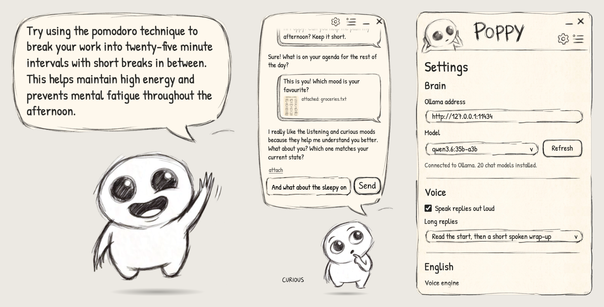
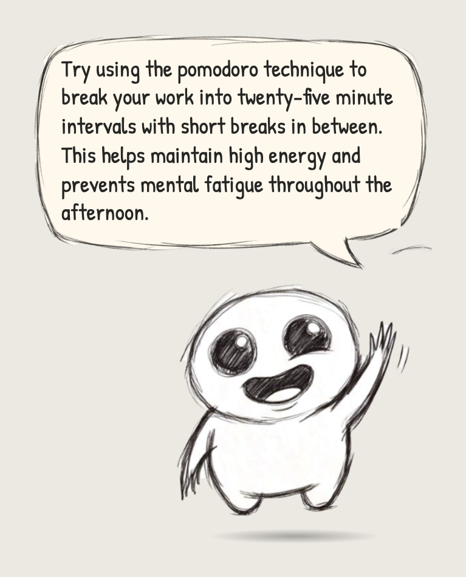
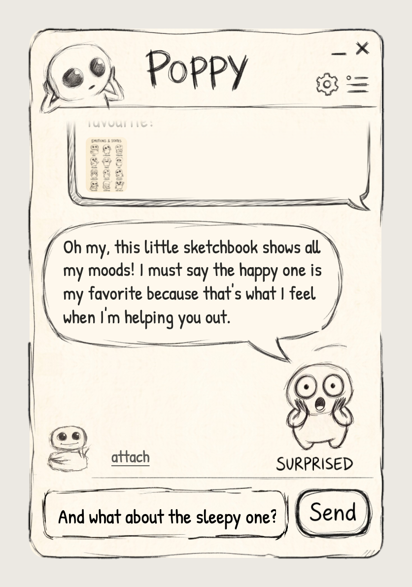
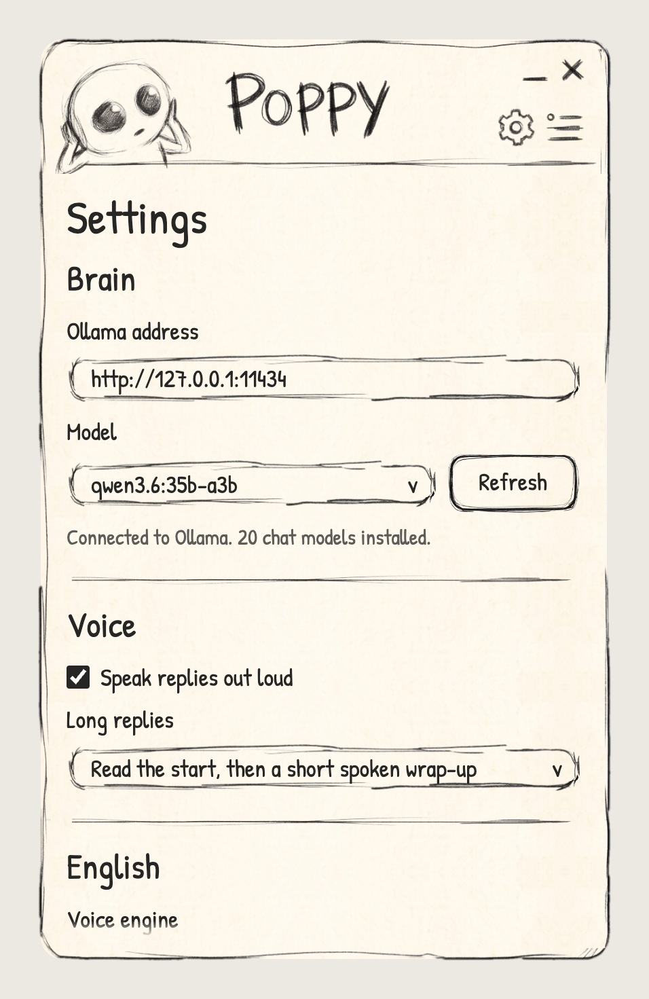
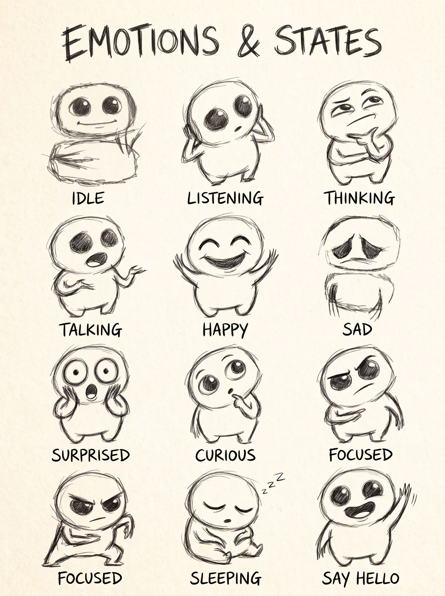

# Poppy

**A hand-drawn desk buddy for macOS that talks with your local Ollama models, or with Claude if you like.**

Poppy is a small pencil-drawn character who sits on your desktop. Click him and a big comic speech balloon pops up above him: that's where you chat. You can ask questions, drop in pictures, PDFs or text files, and he answers out loud. And he keeps learning: he remembers what you tell him, builds a small map of the people and things in your life, and learns from your feedback how you like to be answered. By default everything runs on your own Mac: the language model runs in [Ollama](https://ollama.com), and the voice is [Kokoro](https://github.com/thewh1teagle/kokoro-onnx) or a built-in Mac voice. No accounts, no cloud, no tracking. If you want quicker, smarter answers, you can give Poppy an Anthropic API key and he answers with Claude Haiku, with Ollama as the backup.



---

## Contents

- [What Poppy can do](#what-poppy-can-do)
- [What you need](#what-you-need)
- [Install and run](#install-and-run)
- [First start](#first-start)
- [Using Poppy](#using-poppy)
- [Attachments](#attachments)
- [Memory: how Poppy learns](#memory-how-poppy-learns)
- [Claude as Poppy's brain (optional)](#claude-as-poppys-brain-optional)
- [Voices and languages](#voices-and-languages)
- [Settings](#settings)
- [Privacy](#privacy)
- [Troubleshooting](#troubleshooting)
- [For developers](#for-developers)
- [Roadmap](#roadmap)
- [License and credits](#license-and-credits)

---

## What Poppy can do

- **Lives on your desktop.** A see-through, always-on-top window in the bottom-right corner. Drag him anywhere; he remembers the spot. Clicks go straight through to your desktop except on Poppy himself.
- **Chats with your local model.** Replies stream in from Ollama, word by word. Or, if you add an API key, from Claude, with Ollama taking over when Claude can't answer.
- **Shows how he feels.** The model starts each reply with a mood (happy, curious, surprised…), and Poppy switches to the matching drawing. There are 12 poses, all hand-drawn.
- **Talks out loud.** English replies use Kokoro, a natural-sounding voice that runs on your Mac. Dutch replies use the Mac voice Xander. Long answers are read up to about 40 words, and then Poppy sums up the rest in a sentence or two.
- **Reads your files.** Drop in images, PDFs, text and code files (up to 5 at a time).
- **Remembers and learns.** Facts about you, a knowledge graph of the people and things you mention, and lessons from your feedback. You can see and delete all of it.
- **Falls asleep** after 10 minutes of quiet and wakes up when you hover over him.
- **Stays out of the way.** No Dock icon; a small menu-bar icon has everything else.

| On the desktop | The chat balloon | Settings |
| --- | --- | --- |
|  |  |  |

## What you need

| | Needed? | Notes |
| --- | --- | --- |
| **macOS** | Yes | Poppy uses macOS tools (`say`, `afplay`). Apple Silicon or Intel. |
| **Node.js 20 or newer** | Yes | Only to build and run Poppy from source. [nodejs.org](https://nodejs.org) |
| **Ollama** with at least one chat model | Yes | [ollama.com/download](https://ollama.com/download) |
| **Python 3 + `kokoro-onnx`** | Optional | For the Kokoro English voice. Without it, Poppy uses a Mac voice. |
| **`nomic-embed-text`** in Ollama | Recommended | For Poppy's memory search. Without it, memory still works but searches by keywords. |
| **Anthropic API key** | Optional | To let Claude answer instead of Ollama. See [Claude as Poppy's brain](#claude-as-poppys-brain-optional). |

**Which model?** Poppy's default is `qwen3.6:35b-a3b` (about 23 GB, needs a Mac with 32 GB of memory or more). It also understands pictures. On a smaller Mac, a small model works fine for chatting:

| Model | Size | Pictures? | Good for |
| --- | --- | --- | --- |
| `qwen3.6:35b-a3b` | ~23 GB | Yes | The best answers; the default |
| `qwen3:4b-instruct-2507-q4_K_M` | ~2.5 GB | No | Fast chat on any Apple Silicon Mac |
| `gemma3:4b` | ~3.3 GB | Yes | Small model that can look at images |

If the default isn't installed, Poppy picks the best model you do have. You can change it any time in Settings.

## Install and run

**1. Install Ollama and pull a model**

```bash
ollama pull qwen3.6:35b-a3b
```

(or one of the smaller models above). For Poppy's memory, also pull the small embedding model (274 MB):

```bash
ollama pull nomic-embed-text
```

Make sure Ollama is running: the Ollama app in the menu bar, or `ollama serve` in a terminal.

**2. Optional: install Kokoro for the natural English voice**

Poppy looks for Python at `/opt/homebrew/bin/python3`, `/usr/local/bin/python3` and `/usr/bin/python3`, in that order.

```bash
python3 -m pip install kokoro-onnx
```

If pip says the environment is "externally managed" (Homebrew Python), use:

```bash
python3 -m pip install --user --break-system-packages kokoro-onnx
```

**3. Get Poppy and start him**

```bash
git clone https://github.com/michelneufeglise/poppy.git
```

```bash
cd poppy && npm install
```

```bash
npm run build && npx electron .
```

Poppy appears in the bottom-right corner of your screen and a small Poppy icon shows up in the menu bar. To stop him, use the menu-bar icon → **Quit Poppy**.

> Poppy runs from the project folder for now; there is no packaged `.app` yet.

## First start

- **Kokoro downloads its voice model once** (about 350 MB) into `~/Library/Application Support/poppy/kokoro/`. Until that's done, English replies use the Mac voice. If you already have the files (`kokoro-v1.0.onnx` and `voices-v1.0.bin`), point Poppy at their folder with `POPPY_KOKORO_DIR=/path/to/folder npx electron .` and he copies them instead.
- **The first reply takes a little longer** (about 10 seconds for a big model) while Ollama loads the model into memory. After that, replies start in about a second.

## Using Poppy

| You want to… | Do this |
| --- | --- |
| Open the chat | Click Poppy |
| Move Poppy | Drag him (or drag the chat balloon by its top edge) |
| Close the chat | The **×** at the top of the balloon, or press Esc |
| Hide Poppy | The **–** at the top of the balloon. Bring him back from the menu-bar icon → Show Poppy |
| Start a new conversation | The **≡** menu at the top of the balloon → New chat |
| Turn the voice on or off | The **≡** menu → Voice, or the menu-bar icon |
| Open settings | The gear at the top of the balloon, or the menu-bar icon → Settings… |
| Put Poppy back in the corner | Menu-bar icon → Reset position |
| Tell Poppy an answer was good, or not | Click **good** or **not quite** under his latest reply |
| See what Poppy knows | Ask "what do you know about me?", or the **≡** menu → Memory… |
| Undo what he just learned | Say "forget that" |

While Poppy works you'll see him change: *listening* while you type, *thinking* while the model works, *talking* while he speaks, and then the mood the model picked. While the chat is open, the name of the current state is written next to his feet.

## Attachments

Click **attach** in the balloon, choose **Attach file…** from the ≡ menu, or simply **drag files onto the balloon**. Each file shows up as a small name tag above the input; click its × to remove it. Then type your question (or nothing at all) and press Send.

| Kind | Files | What Poppy does with it |
| --- | --- | --- |
| Images | `.png .jpg .jpeg .gif .webp .bmp` | Sends the picture to the model (scaled down to at most 1600 px). The model must support images. |
| PDFs | `.pdf` | Reads the text from every page. Scanned PDFs without a text layer have no text to read. |
| Text and code | `.txt .md .csv .json .yaml .html .py .ts .js .swift .go .rs .sql` and many more | Adds the text to your message. |
| Anything else | `.zip .docx .mov` … | Refused with a short note. |

Limits: up to **5 files** per message and **20 MB** per file. Very long text is cut at about 60,000 characters per file (and 120,000 per message), and Poppy is told it was cut. For long files, Poppy asks Ollama for a bigger context window automatically.

Pictures are sent only with the message they belong to; the text of files stays part of the conversation, so you can ask follow-up questions about them.

## Memory: how Poppy learns

Poppy can't retrain his language model (Ollama runs models, it doesn't train them). Instead he learns the way a good assistant does: he keeps a memory of what you tell him and feeds it back into every reply. The chat itself is the feedback loop.

1. **Recall, before he answers.** Poppy looks up what fits your message: facts about you, related people and things from his knowledge graph, and his own notebook of rules. A short note with those goes into his instructions. (This takes a few tens of milliseconds.)
2. **Learn, after he answers.** Once he has finished talking, his own model reads the exchange and writes down what's worth keeping: facts ("The user works as a designer at Acme"), people, places and projects, and how they're linked ("Lisa — sister of → you"). When something you say makes an older fact untrue, the old one is switched off.
3. **Feedback.** Click **good** or **not quite** under a reply, or simply correct him ("no, I meant…", "too long"). Poppy turns that into a lesson about how you like to be answered.
4. **Reflect, when it's quiet.** After 10 quiet minutes (at most once an hour) he tidies up: merges duplicate facts and names, lets facts that never come up slowly fade, and rewrites his **notebook**, a short list of rules for himself that's part of every reply.

Your conversation is saved too, so after a restart the balloon shows where you left off.

**You stay in control.** The **Memory** window (≡ menu → Memory…, or Settings → Open memory…) lists everything Poppy knows: facts about you, his notebook and lessons, and the people and things with their links. Click the × next to anything to delete it. **Tidy up now** runs the reflection straight away, and **Forget everything** wipes all chats and memories. **Learn from our chats** (in the Memory window and Settings) pauses learning; what he already knows is still used.

Everything is stored in one file on your Mac: `~/Library/Application Support/poppy/memory.db`. Learning runs on the same brain as the chat (Ollama, or Claude when that's switched on); memory search always uses your own Ollama.

## Claude as Poppy's brain (optional)

Poppy can answer with Claude (Haiku 5.5 by default) instead of your local model. Claude answers quickly, without the 10-second model load, and is better at hard questions. Ollama stays as the backup: when Claude can't answer (you're offline, a limit is hit, the key is wrong), Poppy quietly answers with Ollama.

1. **Get an API key.** Sign in at [platform.claude.com](https://platform.claude.com) (formerly console.anthropic.com), add some credit under **Billing**, then open **API keys** and click **Create key**. The key starts with `sk-ant-`. This is a pay-as-you-go account; it's separate from a Claude Pro or Max subscription, which apps like Poppy can't use.
2. **Give it to Poppy.** Settings → Brain → paste the key → **Save**. Poppy checks the key, saves it, and switches to Claude.
3. **Switch back any time.** Settings → Brain → *Who answers* → **Ollama only**, or use the menu-bar icon (and the ≡ menu): **Claude** / **Ollama only**.

**What it costs:** Haiku 5.5 costs $0.10 per million tokens in and $0.50 per million out. A chat reply plus the learning step is usually well under a tenth of a cent, so roughly a dollar per thousand chats. You can pick Sonnet or Opus in Settings for harder work; they cost more.

**Your key:** stored encrypted with your Mac's Keychain (Electron's `safeStorage`), in `~/Library/Application Support/poppy/secrets.json`. It's never written to `settings.json`, never shown again in full, and only ever sent to `api.anthropic.com`. **Remove key** in Settings deletes it.

**What goes to Anthropic** while Claude is the brain: your messages, attached files, the short memory note that goes with each message, and the exchanges Poppy learns from. Memory search (embeddings) and the voice stay on your Mac.

## Voices and languages

| Language | Voice | Notes |
| --- | --- | --- |
| English | **Kokoro** (default voice `af_heart`, 16 voices to choose from) | Runs on your Mac in a small Python helper. If it fails or is too slow, that sentence falls back to a Mac voice. |
| English | Mac voice (optional) | Pick "Mac voice" as the English engine in Settings. |
| Dutch | Mac voice **Xander** | Kokoro has no Dutch. |
| Others | English route | Spoken with the English voice. |

Poppy picks the language once per reply, by looking at the reply and at your message. He speaks one sentence at a time while the reply is still coming in, so he starts talking quickly.

**Long replies.** By default Poppy reads the first ~40 words. If the rest is short he reads it too; otherwise he asks the model for a one- or two-sentence spoken wrap-up of the rest. Code blocks and tables are not read out; he just says they're on screen. Set **Long replies → Read everything** if you'd rather hear it all.

More Mac voices can be added in **System Settings → Accessibility → Spoken Content → System Voice → Manage Voices…**.

## Settings

Open them from the gear in the chat balloon or the menu-bar icon → Settings…. Changes are saved right away.

| Setting | What it does |
| --- | --- |
| Who answers | **Claude, with Ollama as backup** or **Ollama only**. Default Ollama only. |
| Anthropic API key | Your key for Claude. **Save** checks it first; **Remove key** deletes it. |
| Claude model | Default `claude-haiku-5-5`. The list comes from your account. |
| Use Ollama when Claude doesn't answer | The backup. On by default. |
| Ollama address | Where Ollama runs. Default `http://127.0.0.1:11434`. |
| Ollama model | Which local model Poppy uses. **Refresh** reloads the list. |
| Speak replies out loud | Voice on or off. |
| Long replies | *Read the start, then a short spoken wrap-up* or *Read everything*. |
| English voice engine | Kokoro or a Mac voice. |
| Kokoro voice and speed | Which Kokoro voice, and how fast. |
| Mac voice (English) | Used for English when the engine is "Mac voice", and as the backup for Kokoro. |
| Dutch Mac voice | Default Xander. |
| Mac voice speed | Speed for all Mac voices. |
| Fall asleep after | Minutes of quiet before Poppy dozes off. Default 10. |
| Learn from our chats | Memory learning on or off. |
| Memory search model | The Ollama embedding model for memory search. Default `nomic-embed-text`; "None" searches by keywords. |

Settings are stored in `~/Library/Application Support/poppy/settings.json`.

## Privacy

- **With Ollama only (the default), everything stays on your Mac.** Poppy only talks to the Ollama address in Settings (your own computer by default).
- **With Claude switched on,** your messages, attached files, the memory note and the exchanges Poppy learns from go to Anthropic's API. See [Claude as Poppy's brain](#claude-as-poppys-brain-optional). Your API key is stored encrypted with the Mac's Keychain.
- The only download is Kokoro's voice model from GitHub, once, on first start.
- Files you attach are read on your Mac and sent only to Poppy's brain (your Ollama, or Claude when it's on). Poppy only reads files you pick or drop yourself.
- Your chats and what Poppy learns are saved in `~/Library/Application Support/poppy/memory.db`, on your Mac only. See and delete them in the Memory window, or use **Forget everything**.
- No analytics, no telemetry, and no accounts unless you add a Claude key yourself.

## Troubleshooting

| Problem | Try this |
| --- | --- |
| "I can't reach Ollama" | Start Ollama (open the app or run `ollama serve`) and check the address in Settings. |
| "No Ollama models are installed yet" | Run `ollama pull <model>`, then press Refresh in Settings. |
| "My model can't look at pictures" | Choose a model that supports images (see the table above). |
| Poppy uses a robotic English voice | Kokoro isn't ready: install `kokoro-onnx` (see step 2), and wait for the first download. The status shows in Settings under English. |
| No sound at all | Check that "Speak replies out loud" is on, and your Mac's volume. |
| The first reply is slow | Normal: Ollama is loading the model. Next replies are fast. |
| Poppy is gone | Menu-bar icon → Show Poppy, or Reset position. |
| Settings says the memory search model isn't installed | Run `ollama pull nomic-embed-text`. Until then Poppy searches his memory by keywords. |
| Settings says the API key didn't work | Check that you copied the whole key (it starts with `sk-ant-`) and that your account at platform.claude.com has credit. |
| Settings says "Last time Claude didn't answer" | Poppy used Ollama for that reply. The reason is shown (offline, a limit, no credit…). It clears after the next good Claude reply. |
| Poppy remembered something wrong | Open the Memory window and click the × next to it, or say "forget that" right after. |

## For developers

### Stack

Electron + [electron-vite](https://electron-vite.org) + TypeScript, no UI framework. The page runs sandboxed with context isolation; everything that touches the system (Ollama, files, sound) happens in the main process and is reached through a small `window.poppy` bridge.

### Commands

| Command | What it does |
| --- | --- |
| `npm run dev` | Run with hot reload |
| `npm run build` | Build into `out/` |
| `npx electron .` | Start the built app |
| `POPPY_DATA_DIR=/tmp/poppy-test npx electron .` | Start with a separate, empty data folder (settings, voice files, memory), like a first start on a new Mac |
| `POPPY_ANTHROPIC_URL=http://127.0.0.1:8787 npx electron .` | Send Claude requests to a local test server instead of `api.anthropic.com` (Poppy ignores `ANTHROPIC_BASE_URL`, so your key can't leak through a stray environment variable) |
| `npm test` | Unit tests (reply parsing, speech clean-up and language, attachment rules, memory logic) |
| `npm run typecheck` | TypeScript check |
| `npm run cut-sheet` | Re-cut Poppy's poses from the emotion sheet |
| `npm run cut-chat` | Re-cut the balloon, bubbles, icons and buttons from the chat-window picture |

### Project layout

```
src/
  main/        Electron main process
    index.ts       windows, menu-bar icon, chat flow, IPC
    brain.ts       who answers: Claude with the Ollama backup, or Ollama only
    claude.ts      Claude client (@anthropic-ai/sdk: streaming, JSON answers, model list)
    secrets.ts     the API key, encrypted with the Keychain (safeStorage)
    ollama.ts      Ollama client (streaming chat, model list, image support check, embeddings)
    voice.ts       speech queue: Kokoro WAVs through afplay, or the Mac's say
    kokoro.ts      talks to the Kokoro helper process
    summary.ts     spoken wrap-up for long replies
    attachments.ts reads attached files (images, PDFs, text)
    memory/        Poppy's memory: database (db.ts) and the recall / learn / reflect loop (index.ts)
    settings.ts    settings.json
  preload/     the window.poppy bridge
  renderer/    the Poppy window (with the chat balloon), the settings window and the memory window
  shared/      types and pure logic (mood tags, speech text, attachment rules, memory, Claude requests and fallback rules)
sidecar/
  kokoro_tts.py  Kokoro text-to-speech over JSON lines on stdin/stdout
scripts/
  cut_sheet.py   cuts the 12 poses out of docs/design/emotions-sheet.jpg
  cut_chat.py    cuts the balloon, bubbles and icons out of docs/design/chat-window.jpg
assets/        the cut-out drawings, the menu-bar icon and the font
docs/design/   the original drawings and the design notes
test/          unit tests (vitest)
```

### How the drawings become the app

Poppy is not redrawn in code. Every pose and every piece of the chat is cut straight out of two hand-drawn pictures:

- [`docs/design/emotions-sheet.jpg`](docs/design/emotions-sheet.jpg): the 12 poses and their names.
- [`docs/design/chat-window.jpg`](docs/design/chat-window.jpg): the speech bubbles (Poppy's bubble, stretched, is the whole chat balloon), the pencil icons, the input and the Send button. The settings window uses its header and frame.

The Python scripts in `scripts/` (OpenCV) cut each piece out, make the paper see-through and save PNGs into `assets/`. The balloon, the bubbles, the input and the settings frame are stretched with CSS `border-image` (9-slice), so the pencil lines keep their shape at any size. Animation only moves whole images (a bob, a hop, a crossfade); it never changes the drawings. Design notes are in [`docs/design/poppy-character.md`](docs/design/poppy-character.md).

<p align="center"></p>

### How a reply works

1. Your message (plus any files) goes to Poppy's brain (Ollama, or Claude with Ollama as the backup) with a short system prompt that asks the model to start with a mood tag like `[happy]`, plus what Poppy remembers that fits.
2. The reply streams in. Poppy strips the mood tag, any `<think>` blocks, markdown and emoji for the bubble, and switches to the mood's drawing.
3. Finished sentences go to the speech queue straight away. Kokoro renders two sentences ahead, so there are no gaps between them.
4. When he's done talking, the exchange is saved and Poppy learns from it in the background.

## Roadmap

- **A graph view** of the people and things Poppy knows, in the memory window.
- **Training data export:** good exchanges as a dataset, to fine-tune a small model on your Mac with Apple's MLX.
- **Co-worker tools:** help with Mail and files in folders you allow, always asking before he sends, moves or deletes anything.
- **Voice input:** talk to Poppy instead of typing.
- **A real `.app`** you can drag into Applications.

## License and credits

- **Code:** [MIT](LICENSE).
- **Drawings:** the Poppy character and all drawings and pictures (`docs/design/`, `docs/screenshots/`, `assets/states/`, `assets/chat/`, `assets/tray/`) are © 2026 Michel Neufeglise, **all rights reserved**. You may run Poppy with them for personal use, but please don't reuse the character or drawings elsewhere. If you build on this code, draw your own buddy! Details in [LICENSE](LICENSE).
- **Font:** [Patrick Hand](https://fonts.google.com/specimen/Patrick+Hand) by Patrick Wagesreiter, SIL Open Font License 1.1 ([`assets/fonts/OFL.txt`](assets/fonts/OFL.txt)).
- **Voice:** [Kokoro-82M](https://huggingface.co/hexgrad/Kokoro-82M) by hexgrad, run through [kokoro-onnx](https://github.com/thewh1teagle/kokoro-onnx) by thewh1teagle.
- **PDF reading:** [pdf.js](https://mozilla.github.io/pdf.js/) by Mozilla.
